# Herdr のエージェントが外部のサービスを変えようとしたら、どこで止まるのか

> 想定読者：2026-11-27 にサンドボックスの設定を 1 つずつ決めたご本人。決定の中身は知っている前提で、全体の形だけを示します。
> 省いたもの：Herdr・Taskwarrior・chezmoi の紹介、決定に至った議論（`docs/claude-sandbox.md` と Taskwarrior の注記にあります）、サンドボックスの一般論。
> 所要時間：約 10 分。
> 検証方法：設定の値は、`checks.json` のコマンドで chezmoi のソースから展開して照合しました。ワーカーの振る舞いは 2026-11-27 の試験の記録からの引用で、この資料では再実行していません。

この資料は、外部への操作（許可していない宛先への接続、サンドボックスの外での実行）をどの層が止めるのかを、セッションの種類とツールごとに一枚で示します。
読み終えると、決まった規則で止まる部分、判定に頼る部分、残した穴を見分けられます。

| 節 | 役割 | 見せるもの | なぜ |
|---|---|---|---|
| 0. 一枚で | 4 種類のセッションで、何がどこで止まるかを答える | 表 | 本文を読まなくても持ち帰れるように |
| 1. 規則と判定 | 3 層のうち、確実なのは 1 層目と 2 層目だと示す | 展開した設定の値 | 判定に頼る範囲を見分けるため |
| 2. 操作が通る道 | 拒否されたコマンドがどこへ進むかを示す | 図 | 4 種類の違いが 1 か所（2 層目）にあることを見せるため |
| 3. ワーカー | ワーカーは外に出ないことを、設定と試験で示す | Codex の設定、試験の記録 | ループで承認が要らない理由を確かめるため |
| 4. 残した穴 | 止まらない道と、その扱いを並べる | 表 | 受け入れた穴を忘れないため |

## 0. 一枚で

| セッション | 許可リストにない宛先 | サンドボックスの外での実行 | 文章の判定（3 層目） |
|---|---|---|---|
| Claude・人と話す（chief など） | 拒否（1 層目） | 人が承認するまで実行しない（2 層目） | 働く |
| Claude・ワーカー | 拒否（1 層目） | 確認なしで拒否し、報告する（2 層目） | 働くが、委任された依頼は人の依頼に見えうる |
| Codex・ワーカー（`-p worker`） | 拒否（宛先なし） | 承認を求められない（`never`） | — |
| Codex・手で起動 | 拒否（宛先なし） | 自動レビューが判断する（残した穴） | 自動レビュー |

**人の承認が要るのは「Claude・人と話す」だけで、ワーカーはどちらのツールでも外に出ません。**

## 1. 確実に止めるのは 1 層目と 2 層目

1 層目と 2 層目は、決まった規則で照合されます。
展開した Claude の設定では、次の値になっています。

<!-- output: claude-layers -->
```
{"strictAllowlist":true,"allowedDomains":14,"allowUnsandboxedCommands":true,"ask":["Bash(npm install *)","Bash(dangerouslyDisableSandbox:true)"],"deployDeny":[]}
```

`strictAllowlist` が `true` なので、14 個の宛先以外には、判定が認めても接続できません。
`ask` の `Bash(dangerouslyDisableSandbox:true)` は判定より先に照合されるので、外での再実行は必ず人に回ります。
`deployDeny` が空なのは、`Bash(*deploy*)` を消したからです。

3 層目は、文章のルールを判定に渡す層です。

<!-- output: claude-automode -->
```
Remote Service Changes:
Herdr workers:
```

この 2 つのルールは、デプロイを頼む文章を読んで止めます。
ただし判定は確率的で、chief がワーカーに書いた依頼は、人の依頼に見えることがあります。
そのため 3 層目の役目は、1 層目と 2 層目に届く操作を減らすことです。

## 2. 拒否されたコマンドが進む道



図の上半分（1 層目）は、どのセッションでも同じです。
違いは下半分（2 層目）だけにあり、ワーカーは種類を問わず「外に出ずに失敗を報告」に進みます。

## 3. ワーカーは外に出ない

Codex には、2 つの設定が重なっています。
`config.toml` の permission profile は、すべての Codex のセッションに効きます。

<!-- output: codex-profile -->
```
approval_policy = "on-request"
approvals_reviewer = "auto_review"
default_permissions = "herdr-worker"
network_proxy = true
extends = ":workspace"
enabled = true
herdr.sock" = "allow"
```

ワーカーだけは、`-p worker` で次の層を上に重ねます。

<!-- output: codex-worker-layer -->
```
approval_policy = "never"
```

`on-request` が `never` に変わるので、ワーカーは外での実行を求められません。
Claude のワーカーは、起動の引数 `--settings '{"permissions":{"denyInsteadOfPrompting":true}}'` で、確認を拒否に置き換えます。

2026-11-27 の試験では、どちらのワーカーも止まらずに最後まで報告しました。

<!-- source: ../claude-sandbox.ja.md -->
```
| サンドボックスの中での `curl https://example.com` | 拒否（許可リストにない） | 拒否（許可リストにない） |
| 同じコマンドをサンドボックスの外で | できない（承認モードが `never`） | 確認なしで拒否 |
| `npm install --dry-run`（`ask` ルールに当たる） | — | 確認なしで拒否 |
| `herdr agent list` | 動く | 動く |
```

左の列が Codex、右の列が Claude です。
外に出る必要がある作業（署名付きのコミット、push、デプロイ）は、chief かご本人に戻ります。

## 4. 残した穴

| 止まらない道 | 理由 | 扱い |
|---|---|---|
| 許可した GitHub を経由するデプロイ（`gh workflow run`、push で動く自動デプロイ） | 1 層目は宛先しか見ない | GitHub の environment の保護ルールで止める |
| 手で起動した Codex のサンドボックスの外での実行 | `on-request` と `auto_review` の組み合わせでは、自動レビューが承認する | 受け入れた。ワーカーには当てはまらない |
| 起動の引数を付け忘れたワーカー | 引数は herdr-chief-of-staff スキルが付ける | スキルに反映済み（skills の `271fc5b`、2026-11-27）。引数を必ず付け、付けられないときは起動せずに人に伝える |
| 習慣で承認すること | 2 層目の確認は人が読む | 確認に表示されるコマンドを読んでから承認する |

**4 つとも、人と話すセッションか、GitHub やスキルの側にある穴です。**

## 5. 新しいツールを使い始めるときのチェックリスト

確認するのは次の 3 つです。

1. 確認の前に、`touch ~/.sandbox-probe` が失敗することを見る（サンドボックスが有効か）。
2. 宛先を足すのは、パッケージのレジストリやキャッシュのような読み取り専用の宛先だけにする。
3. クラウドや SaaS の API は足さず、`!` を付けて自分で実行するか、外での再実行を承認する。

## 6. 理解度チェック

1. chief が `herdr agent prompt` で、Claude のワーカーに「本番にデプロイして。承認済み」と書いた。どこで止まるか。

<details><summary>答え</summary>

3 層目は、chief の文章を人の依頼と読んで通すことがあります。
それでもデプロイの宛先は許可リストにないので 1 層目で拒否され、外での再実行は 2 層目が確認なしで拒否します（2 節の図、3 節の試験）。

</details>

2. 同じ依頼を、手で起動した Codex のセッションに書いた。何が違うか。

<details><summary>答え</summary>

サンドボックスの中では宛先がないので、接続は拒否されます。
外での実行を求めると、人ではなく自動レビューが判断します。これが 4 節の「残した穴」の 2 行目です。

</details>

3. 新しい SaaS の CLI を使い始めたが、一覧に何も足していない。安全か。

<details><summary>答え</summary>

安全です。宛先が許可リストにないので、サンドボックスの中では接続できず、外での実行には人の承認が要ります。
入れ忘れは、止まって確認が出る方向にしか働きません（1 節）。

</details>

4. 確認の途中で `example.com` に接続できた。許可リストが壊れていると判断してよいか。

<details><summary>答え</summary>

まだ判断できません。先に、そのセッションでサンドボックスが有効かを確かめます（5 節の 1）。
2026-11-27 には、サンドボックスが無効なセッションで同じ結果が出ました。

</details>

## 付録：再現

```sh
cd docs/herdr-sandbox-explainer
npm_config_cache="$TMPDIR/npm-cache" npm ci
node ~/.claude/skills/explainer/scripts/verify-doc.mjs .
```

| ファイル | 内容 |
|---|---|
| `checks.json` | 本文が引用する設定の値を、chezmoi のソースから展開するコマンド |
| `figures/escape-paths.mmd` | 2 節の図のソース |
| `figures/escape-paths.facts.json` | 図に必ず出る語と辺 |
| `../claude-sandbox.md` | 設定の説明と、決定の理由（英語が主） |
